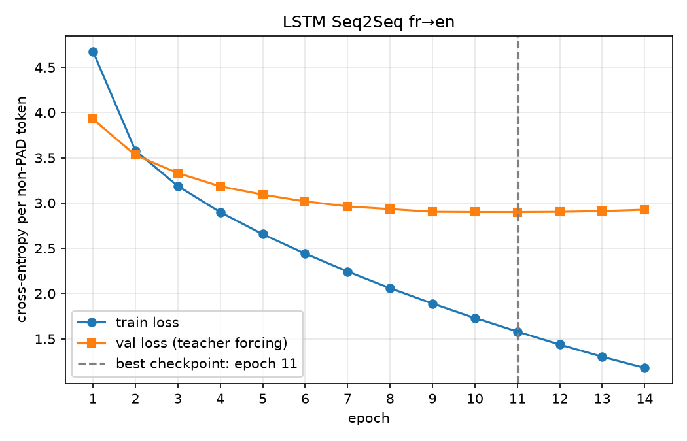

# LSTM Seq2Seq: French → English Translation

A PyTorch encoder–decoder (LSTM, no attention) that translates short French sentences into English, trained on 8,000 Tatoeba sentence pairs.

## Results

| | |
|---|---|
| Test corpus BLEU | **11.39** (1,000 sentences, greedy decoding, no teacher forcing) |
| Best checkpoint | epoch 11 of 14 (validation loss 2.9008; early stopping) |
| Model | 2.05 M parameters, 128-d embeddings and hidden state |
| Training time | ~40 s on CPU |
| sacreBLEU signature | `nrefs:1\|case:mixed\|eff:no\|tok:none\|smooth:exp\|version:2.6.0` |



## Code structure

```
French ids → Embedding → LSTM ──(h, c)──▶ LSTM → Linear → English logits
                encoder                      decoder (previous English token in)
```

- **`data_prep.py`** — Unicode normalisation, regex tokenisation, length filter (≤10 tokens), French-side deduplication, seeded 8k / 1k / 1k split
- **`dataset.py`** — training-only vocabularies, `Dataset` / `DataLoader` with in-batch padding, true lengths and one-step-shifted targets
- **`model.py`** — encoder with `pack_padded_sequence` so padding never reaches the final state; decoder initialised from the encoder's `(h, c)`; greedy decoding
- **`train.py`** — token-averaged cross-entropy ignoring `<PAD>`, Adam, gradient clipping, validation-based checkpointing and early stopping
- **`evaluate.py`** — `translate(sentence)`, corpus BLEU, seeded sample, failure-case candidates
- **`tests/`** — pytest checks for normalisation, tokenisation, filtering, deduplication and the split
- **`outputs/`** — best checkpoint, loss curve, training and evaluation logs, all test translations

## Run

```bash
python3 -m venv .venv && source .venv/bin/activate
pip install -r requirements.txt -r requirements-dev.txt
```

Download the data into `data/`:

```bash
mkdir -p data
curl -L -A "Mozilla/5.0 (Macintosh; Intel Mac OS X 10_15_7) AppleWebKit/537.36 (KHTML, like Gecko) Chrome/126.0 Safari/537.36" -o data/fra-eng.zip https://www.manythings.org/anki/fra-eng.zip
unzip -o data/fra-eng.zip -d data
```

```bash
python -m pytest     # data-processing tests
python train.py      # → outputs/best_model.pt, loss_curve.png, history.json
python evaluate.py   # → test BLEU, examples, failure cases, outputs/test_*.json*
```

```python
>>> from evaluate import translate
>>> translate("Où est la gare ?")
"where ' s the door ?"
```

## Data

Tatoeba French–English pairs from [ManyThings.org](https://www.manythings.org/anki/) (release 2026-02-13), CC-BY 2.0 (France). Attribution: www.manythings.org/anki and tatoeba.org.

## License

Code: [MIT](LICENSE) © 2026 Hanchen Zhang. The Tatoeba data keeps its own CC-BY 2.0 licence (see Data above) and is not included in this repository.
