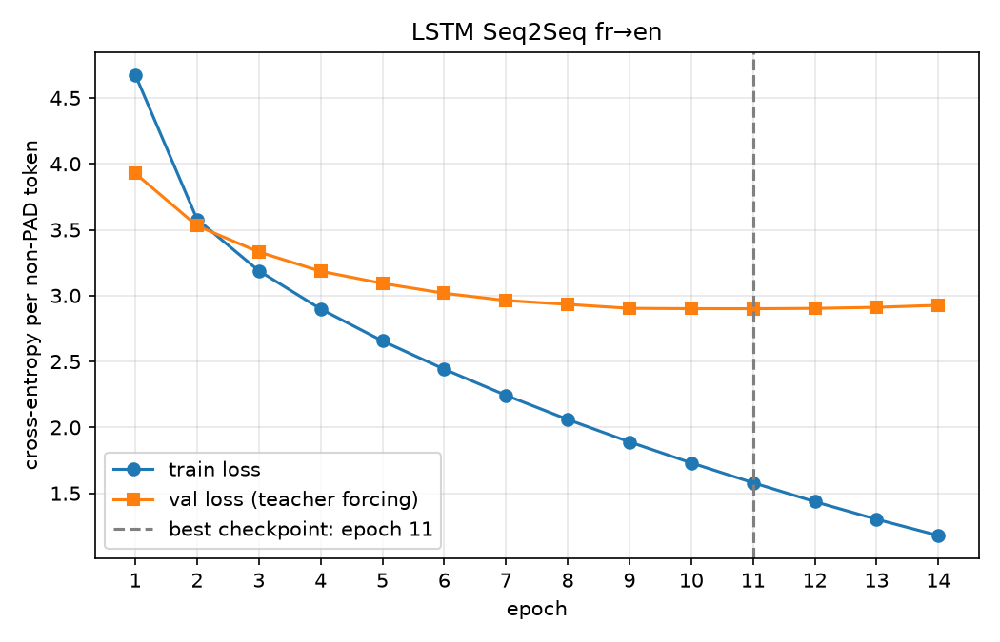

# Report: French→English Short-Sentence Translation with an LSTM Encoder–Decoder

*中文版：[docs/report_zh.md](docs/report_zh.md)*

## 1. Data

**Source.** Tatoeba French–English parallel corpus as packaged by ManyThings.org (https://www.manythings.org/anki/, `fra-eng.zip`, release dated 2026-02-13). Licence CC-BY 2.0 (France); attribution: www.manythings.org/anki and tatoeba.org. The third column (per-sentence attribution) is kept in the raw file and not used for training.

**Preprocessing**, applied identically to training, inference and the BLEU references:

1. Unicode NFC; no-break space `\xa0`, narrow no-break space ` ` and thin space ` ` become a plain space; zero-width space and soft hyphen are removed; curly quotes `’ ‘` become `'`
2. Lowercase
3. Tokenise with `\w+|[^\w\s]`: a run of letters/digits is one token, every punctuation mark is its own token (`don't` → `don ' t`)

**Filtering and split:**

| Step | Pairs |
|---|---|
| Raw pairs | 240,521 |
| Drop pairs with an empty side or more than 10 tokens on either side (punctuation counts) | −68,258 |
| Deduplicate on the processed French, keeping the first qualifying translation | −22,849 |
| Qualifying pairs | 149,414 |
| `random.Random(42).shuffle`, take the first 10,000 | train 8,000 / val 1,000 / test 1,000 |

**Vocabularies** are built from the training split only and include `<PAD> <SOS> <EOS> <UNK>`: French 5,778, English 4,088. The French out-of-vocabulary rate is 5.9% of validation tokens and 5.7% of test tokens; 352 of the 1,000 test sentences contain at least one OOV word.

**Batching.** The `Dataset` stores id sequences; `collate_fn` pads within each batch and returns the true French lengths. Targets are shifted by one position:

```
decoder input: <SOS> i am happy .
target:        i am happy . <EOS>
```

## 2. Model

Encoder–decoder without attention, 2,054,392 parameters (`model.py`):

- **Encoder:** French ids → `nn.Embedding(5778, 128)` → one-layer unidirectional `nn.LSTM(128, 128)`. Inputs are packed with `pack_padded_sequence`, so the final `(h, c)` comes from each sentence's last real token rather than from reading `<PAD>`. Checked: encoding a sentence alone and inside a padded batch gives the same `h`.
- **State transfer:** the encoder's final `h` and `c` together initialise the decoder LSTM.
- **Decoder:** previous English token → `nn.Embedding(4088, 128)` (separate embedding table) → one-layer unidirectional `nn.LSTM(128, 128)` → `nn.Linear(128, 4088)`, producing raw logits.

## 3. Training

| Hyperparameter | Value |
|---|---|
| Embedding / hidden size | 128 / 128 |
| LSTM layers | 1 |
| Batch size | 32 |
| Optimiser / learning rate | Adam / 0.001 |
| Gradient clipping | max norm 1.0 |
| Teacher forcing ratio | 1.0 |
| Max epochs / early stopping | 20 / 3 epochs without a new best validation loss |
| Seed | 42 (`random`, `torch` and the DataLoader shuffle) |

- Loss: `CrossEntropyLoss(ignore_index=pad_id)` on raw logits.
- Epoch loss is averaged over non-PAD tokens: each batch loss is weighted by its non-PAD token count.
- **Validation loss also uses teacher forcing** (the decoder sees the true previous token), so it measures next-token prediction given a correct prefix, not free generation.
- The best checkpoint is chosen on validation loss only; the training script never loads the test split.
- Trained on CPU at about 3 s per epoch. Rerunning with the same seed reproduces every epoch's loss exactly.



| Epoch | Train loss | Val loss |
|---|---|---|
| 1 | 4.6747 | 3.9269 |
| 2 | 3.5785 | 3.5291 |
| 3 | 3.1878 | 3.3312 |
| 4 | 2.8986 | 3.1847 |
| 5 | 2.6560 | 3.0929 |
| 6 | 2.4417 | 3.0179 |
| 7 | 2.2435 | 2.9630 |
| 8 | 2.0600 | 2.9335 |
| 9 | 1.8898 | 2.9036 |
| 10 | 1.7305 | 2.9012 |
| **11** | **1.5802** | **2.9008 (best)** |
| 12 | 1.4363 | 2.9032 |
| 13 | 1.3028 | 2.9115 |
| 14 | 1.1798 | 2.9267 (stopped) |

**Best checkpoint: epoch 11**, validation loss 2.9008. From epoch 9 the validation loss is flat while the training loss keeps falling quickly, so the model is starting to overfit the 8,000 training pairs.

## 4. Test BLEU

The best checkpoint translates all 1,000 test sentences with greedy decoding (no teacher forcing, no access to references), up to 15 tokens each. Predicted and reference tokens are joined with spaces; references are the original preprocessed text, with OOV words left as they are rather than replaced by `<UNK>`.

| Item | Value |
|---|---|
| **Corpus BLEU** | **11.39** |
| Detail | `BLEU = 11.39 45.8/14.7/7.7/3.3 (BP = 1.000 ratio = 1.050 hyp_len = 7036 ref_len = 6700)` |
| Software | sacreBLEU 2.6.0 |
| Signature | `nrefs:1\|case:mixed\|eff:no\|tok:none\|smooth:exp\|version:2.6.0` |

Computed as `BLEU(tokenize="none", force=True).corpus_score(predictions, [references])`. `force=True` only silences sacreBLEU's warning that the text looks tokenised (scoring tokenised text is intended here) and does not change the score.

**BLEU by group:**

| Group | Sentences | BLEU |
|---|---|---|
| French 1–5 tokens | 176 | 17.45 |
| French 6–7 tokens | 343 | 10.76 |
| French 8 tokens | 172 | 10.77 |
| French 9–10 tokens | 309 | 10.28 |
| Source has OOV words | 352 | 8.73 |
| Source has no OOV words | 648 | 12.68 |

Unigram precision is 45.8%, so the model usually picks relevant English words; 4-gram precision is only 3.3%, so it rarely gets longer stretches right. 3 of the 1,000 outputs match the reference exactly.

## 5. Ten test examples

Drawn with `random.Random(42).sample(range(1000), 10)` (test indices 25, 104, 114, 142, 228, 250, 281, 654, 754, 759):

| # | French | Reference | Output |
|---|---|---|---|
| 1 | tu ne sais rien . | you know nothing . | you can ' t be . |
| 2 | personne ne te demande de manger ça . | no one is asking you to eat that . | no one would you like to do that . |
| 3 | vous ne pouvez pas avoir trente ans ! | you can ' t be thirty years old . | you can ' t have a little . |
| 4 | ceux - ci sont véritables . | these are genuine . | they are singing . |
| 5 | y a - t - il un message ? | is there a message ? | is it a few minutes ? |
| 6 | c ' est un charmant jeune homme . | he ' s a lovely young man . | it ' s a man in the woods . |
| 7 | j ' aurais aimé avoir meilleure mémoire . | i wish i had a better memory . | i can ' t wait for you . |
| 8 | je suis à l ' extérieur . | i ' m outside . | i ' m in the room . |
| 9 | et si je dis non ? | what if i say no ? | what i can ' t you ? |
| 10 | il a décidé de ne pas y aller . | he decided not to go . | he is no longer yet . |

These are typical. The model usually gets the **sentence frame** right — subject (no one / he / i ' m), negation (can ' t), question form and final punctuation — but often swaps the **content words** for frequent training phrases (in the room, a few minutes, a little). Examples 2, 3, 6 and 8 start correctly and drift in the second half.

## 6. Failure analysis

### Case 1: Repetition

| French | Reference | Output |
|---|---|---|
| c ' est vraiment beau . | it ' s really beautiful . | it ' s really **really** good . |
| tu as toujours le choix . | you always have a choice . | you ' ve always **always** right . |
| je viens juste de rentrer du travail . | i just got back from work . | i just **just** wanted to the same . |

17 test outputs repeat a token back to back. The decoder has no explicit record of what it has already said; that information lives only implicitly in the 128-dimensional `h, c`. After emitting `really` the state changes little, so `really` is still the most probable next token, and greedy decoding cannot revise earlier choices. Training with full teacher forcing adds to this: the decoder never saw its own mistakes as input (exposure bias).

### Case 2: Unknown words

| French (OOV in bold) | Reference | Output |
|---|---|---|
| **corrigez** les mots **soulignés** . | correct the underlined words . | thanks down the rules . |
| le **tissu** était **teinté** d ' un rouge **éclatant** . | the cloth was dyed bright red . | the meeting was canceled of her dreams . |
| je ne me **sentais** pas bien . | i didn ' t feel well . | i don ' t know who . |

Sentences with OOV words score 8.73 BLEU against 12.68 for the rest. The vocabulary keeps every training word (`min_freq=1`), so **`<UNK>` never appears in the training input and its embedding stays at its random initial value.** At test time several key words collapse onto the same untrained vector and the encoder gets no meaning from them. `sentais` is just an imperfect-tense form of `sentir` (to feel); other forms may be in training, but word-level tokens treat it as brand new. For the same reason the model **never outputs `<UNK>`**: there is no `<UNK>` in the English training targets.

### Case 3: Omission

| French | Reference | Output |
|---|---|---|
| sa maison est au pied de la montagne . | her house is at the foot of the mountain . | his house is in the room . |
| reposons - nous . | let ' s take a rest . | we need . |
| nous vous aiderons à faire cela . | we ' ll help you do that . | we should do you . |

After the subject and first few words the decoder loses track of the source and closes with a common phrase or `<EOS>`; `au pied de la montagne` is never translated. The whole French sentence is squeezed into one 128-dimensional `(h, c)`, whose influence fades as decoding goes on, so the model leans on English language-model habits (`is in the room` is frequent in training). Examples 2 and 3 also contain OOV verb forms (`reposons`, future-tense `aiderons`), compounding Case 2.

### Case 4: Longer sentences drift completely (no OOV)

| French | Reference | Output |
|---|---|---|
| la fête s ' est terminée à neuf heures . | the party ended at nine . | food is getting and all of them . |
| prends un peu de sommeil , d ' accord ? | get some sleep , okay ? | are not going to get my friend . |

Neither sentence has an OOV word, yet both are wrong. BLEU is 10.28 for 9–10-token sources against 17.45 for 1–5 tokens. Without attention, every decoder step sees only the same fixed-size sentence vector and cannot look back at a specific source word; the longer the sentence, the more is lost in compression, and multi-token constructions such as `s ' est terminée` (ended) are hard to keep.

### Low BLEU, but not wrong

| French | Reference | Output | Note |
|---|---|---|---|
| nous y allons maintenant . | we ' re going now . | we ' re going to go now . | Meaning preserved; extra `to go` |
| je dois entrer . | i need to go in . | i have to go . | `have to` ≈ `need to`; only `in` missing |
| sa maison est … | **her** house … | **his** house … | French `sa` agrees with `maison`, not the owner; both readings are valid |

There is one reference per sentence and it is not the only correct translation. BLEU counts n-gram overlap only, so paraphrases and genuine ambiguity are scored as errors.

## 7. Discussion

**Why can the encoder and decoder handle inputs and outputs of different lengths?**
An LSTM applies the same weights at every time step and runs for as many steps as the sequence has, so it can read any length and still end with a fixed-size `(h, c)`. The encoder compresses the whole French sentence into that state; the decoder starts from it and emits one English token per step until it produces `<EOS>` (or hits the 15-token cap), so output length is decided by the model, independently of input length. In a batch, sentences of different lengths are padded with `<PAD>`; packing with the true lengths and `ignore_index` in the loss keep padding out of both the encoding and the gradients.

**What do the LSTM's h and c do?**
`c` (cell state) is a conveyor belt through time: each step keeps a fraction of it through the forget gate and adds new information through the input gate, using mainly element-wise additions and multiplications, so gradients flowing back along `c` vanish less and long-range information survives. `h` (hidden state) is the part of `c` exposed at the current step, after tanh and the output gate: it is the step's output (fed to the Linear layer in the decoder) and an input to next step's gates. Here the encoder hands both over: `c` carries the sentence's long-term memory and `h` drives the decoder's first gates and output.

**How does teacher forcing differ from inference, and what problems can that cause?**
With a ratio of 1.0, every training decoder step receives the **true** previous English token. At inference there is no reference, so each step receives the **model's own** previous prediction. This creates **exposure bias**: the model never saw a wrong prefix during training, so after one wrong step at inference its inputs leave the training distribution and errors compound — drift in the second half, repetition, omission (Section 6). For the same reason the teacher-forced validation loss (2.90) only measures next-token prediction from a correct prefix and is optimistic about real generation, which is why BLEU is computed on free-running output.

**Why ignore PAD in the loss, and why must the test set stay out of the vocabulary?**
PAD is a placeholder that makes the batch rectangular, not something to predict. Counting it would (1) spend capacity on the trivial task of predicting `<PAD>` after the sentence ends and pull the loss down so it looks better than it is, and (2) make a sentence's weight depend on how much padding its batch needs. Ignoring PAD makes the loss the mean cross-entropy over real tokens.
The test set stands in for unseen data. Building the vocabulary with it would reveal which words appear there, push the OOV rate to zero and give an optimistic estimate — a form of data leakage. It matters a lot here: 35% of test sentences contain OOV words, and they score clearly lower.

**Why can't training loss or a few good examples show translation quality?**
Training loss measures fit to the **training** set. From epoch 11 to 14 it fell from 1.58 to 1.18 while validation loss rose from 2.90 to 2.93 — lower training loss meant more overfitting. It is also computed under teacher forcing, so it ignores error accumulation during generation. A handful of good examples suffers from selection bias: short, frequent sentences are easy (`où est le beurre ?` → `where ' s the …`), yet only 3 of 1,000 test outputs match the reference exactly. Quality has to be measured on the full held-out test set, which played no part in training or model selection, with an automatic metric (BLEU) alongside a systematic look at random samples and failures — remembering that BLEU itself underrates valid paraphrases.

## 8. Limitations and next steps

- **Attention:** let every decoder step look back at all encoder outputs; expected to help most with long sentences and omissions.
- **Unknown words:** `min_freq=2` so rare training words become `<UNK>` and its embedding gets trained; or subword units (BPE) so `sentais` shares pieces with known forms.
- **Overfitting:** dropout, weight decay, or more data (149,414 pairs qualify; only 10,000 were used).
- **Decoding:** beam search instead of greedy decoding to reduce repetition and local errors.
- **Exposure bias:** scheduled sampling, gradually lowering the teacher forcing ratio.

## 9. Reproduce

```bash
python -m pytest     # data-processing tests
python train.py      # ~40 s on CPU → outputs/best_model.pt, loss_curve.png, history.json
python evaluate.py   # test BLEU, 10 examples, failure-case candidates → outputs/test_*.json*
```

Environment: Python 3.14, PyTorch 2.14.1 (CPU), sacreBLEU 2.6.0, matplotlib 3.11.2.
